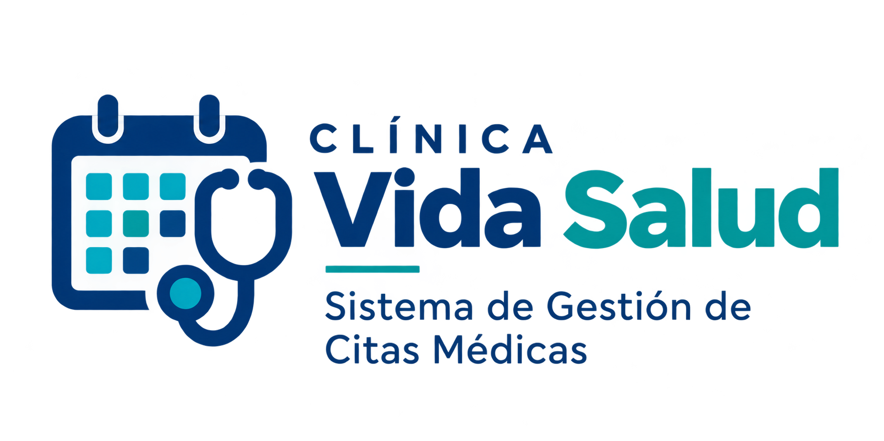

# SISTEMA WEB PARA LA GESTIÓN DE CITAS MÉDICAS PARA LA CLÍNICA VIDA SALUD 
* **Nombres**: 
                Gabriel Mamani Sandoval - 224071572
                Gabriel Condori Hurtado - 224027077
* **Materia**: Ingenieria de Requisito y Modelado INF343-SC
* **Grupo**: Seven


_FICCT-UAGRM-SANTA CRUZ DE LA SIERRA_

## Stack

PHP 8.3 sin framework (MVC propio en español) · PostgreSQL 16 con PDO `pdo_pgsql` · HTML + Tailwind (compilado) + JavaScript vanilla · Apache · Docker.
La interfaz se diseñó con V0 siguiendo la guía [docs/SKILL-ui.md](docs/SKILL-ui.md) y se convirtió a plantillas PHP.

## Ejecución local

Requisitos: Docker con Docker Compose.

```bash
docker compose up --build          # http://localhost:8080 (PUERTO_APP=8090 si el 8080 está ocupado)
docker compose down -v             # borra la base; al volver a subir se recrea con 001–004
```

- Cuentas de demostración (contraseña `VidaSalud2026`): `admin`, `rosa.ag` (recepción), `dr.perez` (médico), `maria.lopez` (paciente).
- Salud del sistema: `/salud`.
- Sin Docker (XAMPP): copiar `.env.example` a `.env`, compilar estilos con `./scripts/css.sh` y apuntar el servidor a `publico/`.
- Pruebas: `composer install && vendor/bin/phpunit`.

## Estructura

```
app/Nucleo/        MVC propio: Enrutador, Solicitud, Respuesta, BaseDatos (PDO), Sesion, Autorizacion, Csrf, Validador, Bitacora
app/Compartido/    layouts, parciales, menú por perfil, portada y panel de inicio
app/Paquetes/      un paquete por grupo de casos de uso, cada uno con:
                   Controladores/ (C*), Modelos/ (E*, una clase por tabla), Vistas/ (V*), plantillas/ y rutas.php
  P1_Seguridad     CU01–CU05 acceso, usuarios y permisos, bitácora, pacientes, médicos   ✔ ciclo 1
  P2_Agenda        CU06–CU10 especialidades, horarios, disponibilidad, reservas         ciclo 1
  P3_Citas         CU11–CU15 cancelación, asistencia, agenda, historial, reportes      ciclo 2
  P4_Atencion      CU16–CU20 historia clínica, consultas, estudios, resultados, pagos  ciclo 2
publico/           punto de entrada (index.php), CSS compilado, JS e imágenes
recursos/          fuente del CSS (Tailwind + sistema Liquid Glass) y logos
bd/                esquema (001), migraciones (002–003) y datos demo (004)
docs/              documentación académica (generador DOCX/PDF) y guía de estilo
pruebas/           PHPUnit
```

La carpeta `privado/` (ignorada por git) guarda material de trabajo del equipo: la exportación original de V0 y referencias de otros proyectos.

## Despliegue

Render (servicio web Docker, plan gratuito) definido en `render.yaml`, con la base en Neon. Cargar `DATABASE_URL` en Render y aplicar `DATABASE_URL=... ./scripts/migrar.sh --con-demo` una sola vez. *(En pausa por ahora.)*
