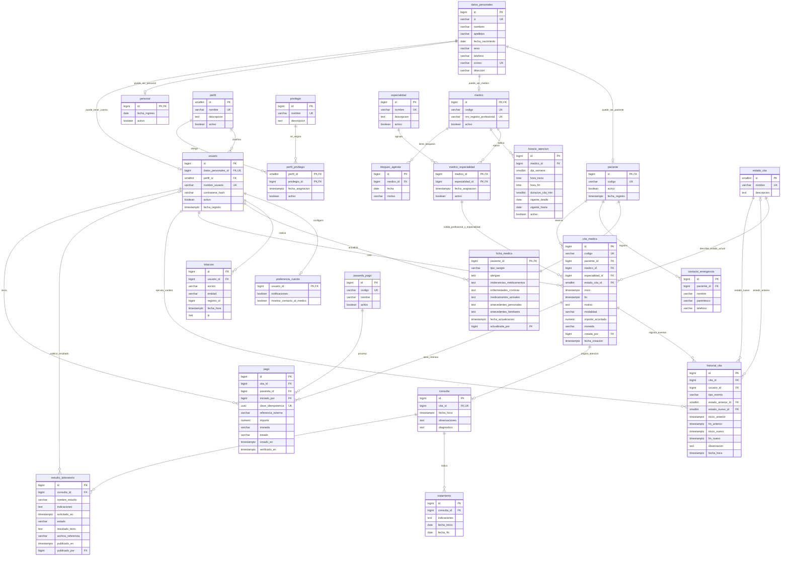

# Modelo de base de datos — Clínica Vida Salud

Documento de diseño para PostgreSQL. Se basa en [Requisitos.md](../Requisitos.md), complementado obligatoriamente por Transcripcion.md. **Esta entrega estructura y documenta la base de datos; no implementa backend, migraciones, autenticación ni integración con una pasarela.** El archivo [backup.mdj](backup.mdj) refleja este esquema en clases UML nativas de StarUML: contiene un único diagrama `Main` con todas las tablas y relaciones, en una presentación compacta en blanco y negro. Los tipos y la nulabilidad se conservan en las propiedades de las columnas; las restricciones están en la documentación de cada tabla. El resumen de cambios compara el resultado con la versión inicial del modelo.

## 1. Criterios de alcance y conciliación

| Tema | Decisión de diseño | Justificación |
| --- | --- | --- |
| Reserva | Pacientes con cuenta pueden reservar; recepción puede registrar pacientes y citas. | Requisitos, perfil del paciente y RF06; transcripción, Audio 1. |
| Duración | Duración configurable por horario, con **15 minutos por defecto**. | RF05/RN08 permiten configuración; clase concreta 15 minutos. Los 30 minutos de Requisitos son un ejemplo. |
| Atención clínica | Incorporar antecedentes, consultas, tratamientos y estudios con resultados digitales. | Perfil del paciente en Requisitos; Audio 1 y Audio 2 de la transcripción amplían el modelo administrativo. |
| Permisos | Cuatro perfiles: administrador, recepcionista, médico y paciente; un perfil por usuario. | Apartado 3 de Requisitos y cuatro perfiles estrictos en los puntos clave de la transcripción. |
| Datos personales | Las correcciones de identidad/contacto de un paciente las realiza recepción o administración autorizada; el paciente administra su cuenta y reserva. | La transcripción precisa el permiso de actualización frente a la edición genérica del perfil de Requisitos. Las actualizaciones clínicas corresponden al médico autorizado. |
| Acceso clínico | El médico solo consulta información de pacientes con citas vigentes asignadas para el día; el paciente ve sus propios resultados publicados. | Restricción expresa del Audio 1. No se deriva acceso global por poseer el rol médico. |
| Pagos | Una cita puede tener varios intentos de pago, con un solo intento pendiente o aprobado a la vez. | Solicitud actual del equipo; Requisitos y Transcripcion no especifican proveedor ni política de cobro. |
| Límites | Atención ambulatoria; quedan fuera urgencias, emergencias y terapia intensiva. | Exclusión expresa del Audio 2. Tampoco se añaden inventario, seguros, hospitalización ni facturación fiscal. |

Se modela una sola clínica, sin sedes diferenciadas; la búsqueda por ubicación del perfil de Requisitos se limita a esa ubicación institucional. Los recordatorios pueden derivarse de las citas próximas y de la preferencia de notificaciones; su programación/envío corresponde a otra etapa.

**Supuestos explícitos para pagos:** se cobra el total de la consulta, sin cuotas, pagos divididos ni anticipos. La reserva ocupa el horario al confirmarse su registro, con independencia del pago; no se exige pagar para reservar porque no lo piden las fuentes. `confirmada` significa confirmación de asistencia, no pago recibido. Se conserva el importe acordado al reservar; no se necesita un motor de tarifas. Una cita gratuita tiene importe cero y no genera pagos. Se usa BOB como moneda inicial configurable, sin conversión de monedas. Son decisiones de esta propuesta, no indicaciones atribuidas al docente.

## 2. Resumen de cambios frente a backup.mdj

La versión inicial contenía **25 clases UML**: 23 entidades con nombre de negocio y dos clases vacías (`Class1` y `Class2`). Sus 100 atributos no tenían tipos de datos definidos; las asociaciones y las generalizaciones tampoco constituían todavía PK/FK físicas. La revisión convierte ese diseño conceptual en un esquema relacional documentado de **24 tablas**.

### 2.1. Eliminaciones

| Elemento previo | Cambio propuesto |
| --- | --- |
| `sesion_chatbot` | Eliminar la entidad completa, incluidos `id`, `fecha_inicio`, `fecha_fin`, `canal`, `estado` y su asociación con paciente. |
| `mensaje_chatbot` | Eliminar la entidad completa, incluidos `id`, `emisor`, `contenido`, `intencion`, `fecha_hora` y sus asociaciones con sesión y cita. |
| Referencias al chatbot | No agregar ni conservar FK de sesión/mensaje en ninguna tabla. En el archivo original esas referencias son asociaciones, no columnas FK explícitas. |
| `Class1`, `Class2` | Descartar las dos clases vacías sin propósito de negocio. |

### 2.2. Tablas nuevas

| Tabla | Motivo |
| --- | --- |
| `pasarela_pago` | Catálogo del proveedor de cobro. |
| `pago` | Intentos de cobro, identificación externa, importe, moneda, estado e idempotencia. |
| `consulta` | Registrar la atención y sus notas/diagnóstico (Audio 2). |
| `tratamiento` | Indicaciones vinculadas a una consulta (Audio 2). |
| `estudio_laboratorio` | Solicitud individual y resultado digital visible cuando se publique (Audio 1). |

### 2.3. Modificaciones y simplificaciones

| Estructura previa | Resultado |
| --- | --- |
| Herencia de `datos_personales` | Agregar PK y convertir paciente, medico y personal en subtipos con PK/FK compartida. |
| `usuario` y `datos_personales` | Explicitar FK 1:1 opcional; eliminar el correo duplicado de usuario y conservar hash de contraseña. |
| `personal.cargo` | Eliminar la duplicación del perfil de acceso; conservar fecha de ingreso y activación. |
| `perfil`, `privilegio`, `perfil_privilegio` | Conservar; definir cuatro perfiles, PK compuesta y permisos sin tabla adicional de roles por usuario. |
| `preferencia_cuenta` | Usar usuario_id como PK/FK; precisar notificaciones y opciones de privacidad. |
| `ficha_medica` | Mantener como cabecera clínica; agregar intolerancias, antecedentes familiares y autor de actualización. Separar antecedentes personales del antiguo campo genérico antecedentes. |
| `medico_especialidad` | Explicitar PK compuesta y referenciar esa pareja desde cita para garantizar especialidad válida. |
| `horario_atencion` | Duración por defecto de 15 minutos y fechas de vigencia. Derivar los cupos, sin tabla de slots ni campo disponible duplicado. |
| `bloqueo_agenda` | Conservar como excepción opcional de día completo; médico obligatorio y unicidad por médico/fecha. |
| `cita_medica` | Explicitar FK, estado, creador e intervalo con zona horaria; agregar importe/moneda. Retirar la asociación física directa a horario: se valida pertenencia a la ventana al reservar. |
| `historial_estado_cita`, `cancelacion_cita`, `reprogramacion_cita` | Reemplazar por `historial_cita`: un solo historial con actor, estado y rangos anterior/nuevo. Mantiene todos los motivos y fechas necesarios sin tres estructuras de auditoría. |
| `estado_cita` | Fijar los cinco estados de RF10. No crear estado pagada en las citas. |
| `bitacora` | Conservar para acciones administrativas; agregar entidad y registro afectados. |
| Resto de las entidades | Conservar identidad, contactos de emergencia, especialidades y desactivación; precisar tipos, claves y restricciones. |

Se uniforman además los nombres: los estados binarios de activación pasan de `estado` a `activo`; `nombre`/`apellido` personales a `nombres`/`apellidos`; `fecha_nac` a `fecha_nacimiento`; y `duracion_cita` a `duracion_cita_min`. Los cambios de nombre no crean atributos adicionales.

Balance: 25 clases iniciales − 2 clases vacías − 2 entidades de chatbot − 3 tablas de historial/cancelación/reprogramación + 1 historial unificado + 3 tablas clínicas + 2 de pagos = **24 tablas propuestas**. No se añaden tablas de reportes, agendas derivadas, recordatorios, sesiones web ni mensajería.

## 3. Definición detallada del esquema

### Convenciones generales

- `PK`: clave primaria; `FK`: clave foránea; `UK`: unicidad de una sola columna o de su valor normalizado. Las restricciones compuestas se describen expresamente después de cada tabla. Todas las PK implican `NOT NULL`.
- `Sí` en la columna «Admite NULL» significa opcional. Salvo indicación contraria, un campo opcional sin dato se guarda como NULL y no como cadena vacía. Nombres, códigos y demás textos obligatorios deben cumplir `btrim(valor) <> ''`.
- Las PK independientes `BIGINT` se recomiendan como `GENERATED BY DEFAULT AS IDENTITY`. Las PK compartidas y compuestas no generan una nueva identidad. Los IDs de catálogo `SMALLINT` se asignan explícitamente.
- Las FK usan `ON DELETE RESTRICT` y claves inmutables (`ON UPDATE RESTRICT`). No se aplican borrados en cascada al historial clínico, a citas ni a pagos. Personas, médicos, pacientes, cuentas y catálogos se desactivan cuando corresponda.
- Fechas de nacimiento y vigencias: `DATE`; horas semanales: `TIME WITHOUT TIME ZONE`; eventos y citas: `TIMESTAMPTZ`. Las reglas del día, la agenda y los horarios se interpretan en **America/La_Paz**, incluso si la sesión de PostgreSQL usa otra zona.
- Dinero: `NUMERIC(12,2)`, nunca FLOAT. Moneda: cadena de tres letras mayúsculas (`^[A-Z]{3}$`); esta comprobación de formato no reemplaza el catálogo de monedas admitidas por el proveedor que se elija.
- Unicidad normalizada de nombres/correos: índice único sobre `lower(btrim(columna))`. CI y registro profesional se guardan en una forma canónica acordada; se preservan letras, complementos y ceros, sin usar tipos numéricos.
- Los valores de estado escritos en las restricciones se implementarán como literales de texto entre comillas. Estas tablas describen el diseño recomendado; no son una migración ya ejecutada.

### 3.1. `datos_personales`

Identidad y contacto compartidos por pacientes, médicos y personal. Sustituye la herencia UML por una tabla base con PK.

| Columna | Tipo PostgreSQL | Clave | Admite NULL | Restricción / significado |
| --- | --- | --- | --- | --- |
| `id` | `BIGINT` | PK | No | Identidad autogenerada. |
| `ci` | `VARCHAR(30)` | UK | Sí | Documento normalizado, único cuando se proporcione; vacío se convierte a NULL. |
| `nombres` | `VARCHAR(100)` | — | No | Texto no vacío. |
| `apellidos` | `VARCHAR(100)` | — | No | Texto no vacío. |
| `fecha_nacimiento` | `DATE` | — | No | No posterior al día del registro; no almacenar la edad calculada. |
| `sexo` | `VARCHAR(30)` | — | Sí | Dato demográfico opcional. |
| `telefono` | `VARCHAR(30)` | — | No | Cadena no vacía; conservar prefijos y ceros. |
| `correo` | `VARCHAR(254)` | UK | Sí | Índice único sobre lower(btrim(correo)); necesario para identificar el acceso por correo sin duplicarlo en usuario. |
| `direccion` | `VARCHAR(250)` | — | Sí | Domicilio. |

La unicidad del CI se aplica a la persona: una misma persona puede ser paciente y médico sin duplicar su identidad. El correo es opcional; si existe, esta propuesta exige que no se comparta entre personas porque también identifica el inicio de sesión. La fecha de nacimiento se valida al escribir el registro, sin CHECK dependiente del reloj.

### 3.2. `paciente`

Registro administrativo del paciente; puede existir sin cuenta de acceso (alta por recepción).

| Columna | Tipo PostgreSQL | Clave | Admite NULL | Restricción / significado |
| --- | --- | --- | --- | --- |
| `id` | `BIGINT` | PK, FK | No | FK → datos_personales(id); PK compartida, sin otra identidad autogenerada. |
| `codigo` | `VARCHAR(20)` | UK | No | Código de paciente no vacío. |
| `activo` | `BOOLEAN` | — | No | DEFAULT TRUE; desactivación lógica. |
| `fecha_registro` | `TIMESTAMPTZ` | — | No | DEFAULT CURRENT_TIMESTAMP. |

### 3.3. `medico`

Profesional habilitado para atender citas.

| Columna | Tipo PostgreSQL | Clave | Admite NULL | Restricción / significado |
| --- | --- | --- | --- | --- |
| `id` | `BIGINT` | PK, FK | No | FK → datos_personales(id); PK compartida. |
| `codigo` | `VARCHAR(20)` | UK | No | Código de médico no vacío. |
| `nro_registro_profesional` | `VARCHAR(50)` | UK | No | Matrícula profesional normalizada y no vacía. |
| `activo` | `BOOLEAN` | — | No | DEFAULT TRUE. |

Teléfono, correo, nombres y apellidos se consultan en datos_personales; no se repiten aquí.

### 3.4. `personal`

Datos laborales mínimos del personal administrativo ya previsto en el modelo original.

| Columna | Tipo PostgreSQL | Clave | Admite NULL | Restricción / significado |
| --- | --- | --- | --- | --- |
| `id` | `BIGINT` | PK, FK | No | FK → datos_personales(id); PK compartida. |
| `fecha_ingreso` | `DATE` | — | No | Fecha de incorporación. |
| `activo` | `BOOLEAN` | — | No | DEFAULT TRUE. |

Se elimina cargo como sustituto del rol de acceso: administrador/recepcionista se determina mediante usuario.perfil_id. No se modelan recursos humanos ni nómina.

### 3.5. `perfil`

Catálogo de los cuatro perfiles de acceso exigidos en clase.

| Columna | Tipo PostgreSQL | Clave | Admite NULL | Restricción / significado |
| --- | --- | --- | --- | --- |
| `id` | `SMALLINT` | PK | No | Identificador de catálogo, asignado explícitamente. |
| `nombre` | `VARCHAR(30)` | UK | No | CHECK IN (administrador, recepcionista, medico, paciente). |
| `descripcion` | `TEXT` | — | Sí | Descripción del rol. |
| `activo` | `BOOLEAN` | — | No | DEFAULT TRUE. |

Se cargan exactamente esos cuatro perfiles. Se administran su activación y sus privilegios; otros perfiles quedan fuera de esta etapa. Un usuario tiene un solo perfil, como en la asociación original.

### 3.6. `usuario`

Cuenta de autenticación vinculada a una persona y a un perfil.

| Columna | Tipo PostgreSQL | Clave | Admite NULL | Restricción / significado |
| --- | --- | --- | --- | --- |
| `id` | `BIGINT` | PK | No | Identidad autogenerada. |
| `datos_personales_id` | `BIGINT` | FK, UK | No | FK → datos_personales(id); una cuenta por persona. |
| `perfil_id` | `SMALLINT` | FK | No | FK → perfil(id). |
| `nombre_usuario` | `VARCHAR(50)` | UK | No | Índice único sobre lower(btrim(nombre_usuario)); no vacío y sin @ para evitar ambigüedad con el acceso por correo. |
| `contrasena_hash` | `VARCHAR(255)` | — | No | Hash seguro; nunca contraseña en texto plano. |
| `activo` | `BOOLEAN` | — | No | DEFAULT TRUE. |
| `fecha_registro` | `TIMESTAMPTZ` | — | No | DEFAULT CURRENT_TIMESTAMP. |

Se elimina usuario.correo porque ya pertenece a datos_personales. Un perfil paciente requiere el subtipo paciente de esa persona; medico requiere medico; administrador o recepcionista requieren personal. Esta coherencia entre tablas es una regla transaccional, no un CHECK local. Las PK compartidas permiten identificar al paciente/médico conectado sin repetir sus identificadores en usuario.

### 3.7. `privilegio`

Catálogo de operaciones autorizables, conservando los permisos básicos del modelo.

| Columna | Tipo PostgreSQL | Clave | Admite NULL | Restricción / significado |
| --- | --- | --- | --- | --- |
| `id` | `BIGINT` | PK | No | Identidad autogenerada. |
| `nombre` | `VARCHAR(80)` | UK | No | Código único no vacío, por ejemplo marcar_cita_atendida. |
| `descripcion` | `TEXT` | — | Sí | Alcance de la operación. |

### 3.8. `perfil_privilegio`

Resuelve la relación N:M entre perfiles y privilegios.

| Columna | Tipo PostgreSQL | Clave | Admite NULL | Restricción / significado |
| --- | --- | --- | --- | --- |
| `perfil_id` | `SMALLINT` | PK, FK | No | FK → perfil(id); primer componente de PK compuesta. |
| `privilegio_id` | `BIGINT` | PK, FK | No | FK → privilegio(id); segundo componente de PK compuesta. |
| `fecha_asignacion` | `TIMESTAMPTZ` | — | No | DEFAULT CURRENT_TIMESTAMP. |
| `activo` | `BOOLEAN` | — | No | DEFAULT TRUE. |

PK (perfil_id, privilegio_id): una sola asignación por pareja. Reactivar la fila evita duplicaciones.

### 3.9. `preferencia_cuenta`

Preferencias de cuenta ya solicitadas en el perfil del paciente.

| Columna | Tipo PostgreSQL | Clave | Admite NULL | Restricción / significado |
| --- | --- | --- | --- | --- |
| `usuario_id` | `BIGINT` | PK, FK | No | FK → usuario(id); como máximo una fila por cuenta. |
| `notificaciones` | `BOOLEAN` | — | No | DEFAULT TRUE; habilita recordatorios futuros. |
| `mostrar_contacto_al_medico` | `BOOLEAN` | — | No | DEFAULT FALSE; preferencia de privacidad para mostrar teléfono/correo al médico autorizado. |

Se concreta el antiguo campo genérico privacidad en una preferencia verificable: mostrar o no los datos de contacto al médico. El acceso a la información clínica necesaria sigue sujeto a la cita del día y a los permisos; esta preferencia no amplía el conjunto de pacientes accesibles. La preferencia de notificaciones no implementa el envío de recordatorios.

### 3.10. `bitacora`

Auditoría mínima de operaciones sobre registros; no sustituye al historial de citas.

| Columna | Tipo PostgreSQL | Clave | Admite NULL | Restricción / significado |
| --- | --- | --- | --- | --- |
| `id` | `BIGINT` | PK | No | Identidad autogenerada. |
| `usuario_id` | `BIGINT` | FK | No | FK → usuario(id); actor autenticado. |
| `accion` | `VARCHAR(80)` | — | No | Operación no vacía, por ejemplo actualizar_datos_paciente. |
| `entidad` | `VARCHAR(60)` | — | No | Nombre de la entidad afectada. |
| `registro_id` | `BIGINT` | — | No | Identificador del registro afectado; referencia descriptiva, no FK polimórfica. |
| `fecha_hora` | `TIMESTAMPTZ` | — | No | DEFAULT CURRENT_TIMESTAMP. |
| `ip` | `INET` | — | Sí | Dirección IP si se conoce. |

No copiar contraseñas, secretos de pago ni historias clínicas completas en la bitácora. registro_id permite localizar el objeto auditado; su integridad no está garantizada por una FK porque puede describir distintas tablas. Es auditoría administrativa, no un bus de eventos.

### 3.11. `ficha_medica`

Cabecera de historia clínica y resumen de antecedentes del paciente. No es la ficha/cupo de reserva.

| Columna | Tipo PostgreSQL | Clave | Admite NULL | Restricción / significado |
| --- | --- | --- | --- | --- |
| `paciente_id` | `BIGINT` | PK, FK | No | FK → paciente(id); una historia por paciente. |
| `tipo_sangre` | `VARCHAR(3)` | — | Sí | CHECK IN (A+, A-, B+, B-, AB+, AB-, O+, O-); NULL significa desconocido. |
| `alergias` | `TEXT` | — | Sí | Resumen clínico narrativo. |
| `intolerancias_medicamentos` | `TEXT` | — | Sí | Nuevo: diferenciar intolerancias de alergias. |
| `enfermedades_cronicas` | `TEXT` | — | Sí | Resumen clínico narrativo. |
| `medicamentos_actuales` | `TEXT` | — | Sí | Medicación declarada al actualizar la ficha. |
| `antecedentes_personales` | `TEXT` | — | Sí | Antecedentes relevantes del paciente. |
| `antecedentes_familiares` | `TEXT` | — | Sí | Nuevo: antecedentes hereditarios/familiares de clase. |
| `fecha_actualizacion` | `TIMESTAMPTZ` | — | No | Momento de la última modificación; actualizar al escribir. |
| `actualizada_por` | `BIGINT` | FK | No | FK → usuario(id); responsable autorizado. |

Se crea la ficha junto al alta del paciente, incluso con datos clínicos aún desconocidos; el tipo de sangre no se inventa ni se usa un valor por defecto. PK/FK asegura como máximo una ficha, y la creación conjunta asegura la participación obligatoria. NULL no equivale a ausencia de alergias: una ausencia constatada debe quedar explícita en la nota. Los TEXT son documentos clínicos narrativos, no listas de IDs ni catálogos separados por comas. Las consultas y tratamientos longitudinales tienen sus propias tablas.

### 3.12. `contacto_emergencia`

Contactos del paciente; cada contacto tiene su propia fila.

| Columna | Tipo PostgreSQL | Clave | Admite NULL | Restricción / significado |
| --- | --- | --- | --- | --- |
| `id` | `BIGINT` | PK | No | Identidad autogenerada. |
| `paciente_id` | `BIGINT` | FK | No | FK → paciente(id). |
| `nombre` | `VARCHAR(150)` | — | No | Nombre no vacío. |
| `parentesco` | `VARCHAR(50)` | — | No | Relación con el paciente. |
| `telefono` | `VARCHAR(30)` | — | No | Teléfono no vacío, almacenado como cadena. |

### 3.13. `especialidad`

Especialidades ofrecidas por la clínica.

| Columna | Tipo PostgreSQL | Clave | Admite NULL | Restricción / significado |
| --- | --- | --- | --- | --- |
| `id` | `BIGINT` | PK | No | Identidad autogenerada. |
| `nombre` | `VARCHAR(100)` | UK | No | Índice único sobre lower(btrim(nombre)); no vacío. |
| `descripcion` | `TEXT` | — | Sí | Descripción. |
| `activo` | `BOOLEAN` | — | No | DEFAULT TRUE. |
| `importe_consulta` | `NUMERIC(12,2)` | — | No | DEFAULT 0; CHECK >= 0. Tarifa vigente que se copia en cita_medica.importe_acordado al reservar (migración 005). |

Datos iniciales obligatorios: Pediatría, Medicina general y Geriatría (Transcripcion.md). Las demás especialidades son ampliables. No se convierten las edades mencionadas como ejemplos en prohibiciones automáticas de atención.

### 3.14. `medico_especialidad`

Relación N:M entre médicos y especialidades; valida la especialidad de cada cita.

| Columna | Tipo PostgreSQL | Clave | Admite NULL | Restricción / significado |
| --- | --- | --- | --- | --- |
| `medico_id` | `BIGINT` | PK, FK | No | FK → medico(id); primer componente de PK compuesta. |
| `especialidad_id` | `BIGINT` | PK, FK | No | FK → especialidad(id); segundo componente de PK compuesta. |
| `fecha_asignacion` | `TIMESTAMPTZ` | — | No | DEFAULT CURRENT_TIMESTAMP. |
| `activo` | `BOOLEAN` | — | No | DEFAULT TRUE. |

PK (medico_id, especialidad_id). Para recibir reservas, un médico activo debe tener al menos una asignación activa; esto se valida al habilitarlo. Las asignaciones referenciadas por citas se desactivan, no se borran.

### 3.15. `horario_atencion`

Ventanas semanales de disponibilidad del médico, con vigencia y duración configurable.

| Columna | Tipo PostgreSQL | Clave | Admite NULL | Restricción / significado |
| --- | --- | --- | --- | --- |
| `id` | `BIGINT` | PK | No | Identidad autogenerada. |
| `medico_id` | `BIGINT` | FK | No | FK → medico(id). |
| `dia_semana` | `SMALLINT` | — | No | CHECK BETWEEN 1 AND 7; lunes=1, domingo=7. |
| `hora_inicio` | `TIME` | — | No | Hora local de la clínica. |
| `hora_fin` | `TIME` | — | No | CHECK hora_fin > hora_inicio; no cruza medianoche. |
| `duracion_cita_min` | `SMALLINT` | — | No | DEFAULT 15; CHECK > 0; la ventana debe dividirse exactamente en estos intervalos. |
| `vigente_desde` | `DATE` | — | No | Primer día aplicable. |
| `vigente_hasta` | `DATE` | — | Sí | NULL para vigencia abierta; CHECK >= vigente_desde cuando exista. |
| `activo` | `BOOLEAN` | — | No | DEFAULT TRUE. |

Para un médico no se permiten ventanas activas superpuestas que coincidan en día de semana y vigencia. Cambiar una ventana no modifica citas ya reservadas: se revisan las futuras antes de aprobar el cambio. No se agrega especialidad_id aquí: los horarios son del médico, como indican RF05 y el modelo previo; la especialidad elegida se valida en medico_especialidad.

### 3.16. `bloqueo_agenda`

Excepción de disponibilidad por un día completo, conservada como mejora opcional ya existente.

| Columna | Tipo PostgreSQL | Clave | Admite NULL | Restricción / significado |
| --- | --- | --- | --- | --- |
| `id` | `BIGINT` | PK | No | Identidad autogenerada. |
| `medico_id` | `BIGINT` | FK | No | FK → medico(id). |
| `fecha` | `DATE` | — | No | Fecha local bloqueada. |
| `motivo` | `VARCHAR(250)` | — | No | Motivo no vacío. |

UNIQUE (medico_id, fecha). Se simplifica la asociación previa opcional: cada bloqueo pertenece a un médico; un feriado general se representa mediante un bloqueo por médico. No se incorporan bloqueos por minutos ni un calendario institucional adicional. Crear un bloqueo no cancela automáticamente citas existentes: deben resolverse explícitamente.

### 3.17. `estado_cita`

Catálogo estable de los cinco estados definidos en RF10.

| Columna | Tipo PostgreSQL | Clave | Admite NULL | Restricción / significado |
| --- | --- | --- | --- | --- |
| `id` | `SMALLINT` | PK | No | Identificador fijo de catálogo: 1..5. |
| `nombre` | `VARCHAR(20)` | UK | No | 1=programada, 2=confirmada, 3=atendida, 4=cancelada, 5=inasistencia. |
| `descripcion` | `TEXT` | — | Sí | Significado del estado. |

Los pares id/nombre se cargan y mantienen fijos; no se eliminan ni reasignan. Esto permite usar estado_cita_id <> 4 en la restricción parcial de no superposición. No se mezclan estados de citas con estados de pagos.

### 3.18. `cita_medica`

Reserva de atención (la ficha de turno mencionada en clase), con su intervalo y precio acordado.

| Columna | Tipo PostgreSQL | Clave | Admite NULL | Restricción / significado |
| --- | --- | --- | --- | --- |
| `id` | `BIGINT` | PK | No | Identidad autogenerada. |
| `codigo` | `VARCHAR(20)` | UK | No | Código de cita no vacío y único. |
| `paciente_id` | `BIGINT` | FK | No | FK → paciente(id). |
| `medico_id` | `BIGINT` | FK | No | Junto con especialidad_id, FK compuesta → medico_especialidad(medico_id, especialidad_id). |
| `especialidad_id` | `BIGINT` | FK | No | Segundo componente de la misma FK compuesta. |
| `estado_cita_id` | `SMALLINT` | FK | No | FK → estado_cita(id); DEFAULT 1 (programada). |
| `inicio` | `TIMESTAMPTZ` | — | No | Inicio reservado, con zona horaria. |
| `fin` | `TIMESTAMPTZ` | — | No | CHECK fin > inicio. |
| `motivo` | `TEXT` | — | Sí | Motivo breve de la consulta. |
| `modalidad` | `VARCHAR(20)` | — | No | DEFAULT presencial; CHECK IN (presencial, virtual), por el perfil de Requisitos.md. |
| `importe_acordado` | `NUMERIC(12,2)` | — | No | CHECK >= 0; precio fijado al reservar, sin DEFAULT implícito de gratuidad. |
| `moneda` | `VARCHAR(3)` | — | No | DEFAULT BOB; código de tres letras mayúsculas. |
| `creada_por` | `BIGINT` | FK | No | FK → usuario(id); paciente que reserva o personal autorizado. |
| `fecha_creacion` | `TIMESTAMPTZ` | — | No | DEFAULT CURRENT_TIMESTAMP. |

No se repiten fecha/hora por separado: se derivan de inicio y fin en America/La_Paz. Tampoco se guarda disponible ni horario_atencion_id: la reserva se valida contra las ventanas vigentes y conserva su intervalo histórico; añadir el horario repetiría la dependencia del médico y acoplaría el historial a una plantilla modificable. La FK compuesta impide seleccionar una especialidad ajena al médico. El importe es el precio particular acordado para esta cita, no un catálogo de tarifas.

### 3.19. `historial_cita`

Registro único de creación, cambios de estado, cancelación y reprogramación; reemplaza tres estructuras previas.

| Columna | Tipo PostgreSQL | Clave | Admite NULL | Restricción / significado |
| --- | --- | --- | --- | --- |
| `id` | `BIGINT` | PK | No | Identidad autogenerada. |
| `cita_id` | `BIGINT` | FK | No | FK → cita_medica(id). |
| `usuario_id` | `BIGINT` | FK | No | FK → usuario(id); responsable. |
| `tipo_evento` | `VARCHAR(20)` | — | No | CHECK IN (creacion, cambio_estado, reprogramacion). |
| `estado_anterior_id` | `SMALLINT` | FK | Sí | FK → estado_cita(id); NULL solo en creacion. |
| `estado_nuevo_id` | `SMALLINT` | FK | No | FK → estado_cita(id); estado tras la operación. |
| `inicio_anterior` | `TIMESTAMPTZ` | — | Sí | Obligatorio solo en reprogramacion. |
| `fin_anterior` | `TIMESTAMPTZ` | — | Sí | Obligatorio solo en reprogramacion. |
| `inicio_nuevo` | `TIMESTAMPTZ` | — | No | Inicio resultante; instantánea histórica. |
| `fin_nuevo` | `TIMESTAMPTZ` | — | No | CHECK fin_nuevo > inicio_nuevo. |
| `observacion` | `TEXT` | — | Sí | Motivo; obligatorio y no vacío al cancelar o reprogramar. |
| `fecha_hora` | `TIMESTAMPTZ` | — | No | DEFAULT CURRENT_TIMESTAMP. |

CHECK locales: creacion tiene estado anterior e intervalo anterior nulos; cambio_estado tiene estados anterior/nuevo distintos e intervalo anterior nulo; reprogramacion tiene ambos intervalos válidos y distintos y conserva el estado. Solo programada/confirmada se reprograman. Cancelar es cambio_estado hacia 4, con motivo. Se inserta un evento inicial y uno por cada modificación relevante en la misma transacción de la cita. Para ordenar eventos se usa (fecha_hora, id). Las filas son inmutables; no se necesita una tabla cancelacion_cita adicional. En esta propuesta reprogramar conserva paciente, médico y especialidad; cambiarlos requiere otra cita y cancelar la previa si procede.

### 3.20. `consulta`

Atención clínica realizada en una cita; nueva por las indicaciones del Audio 2.

| Columna | Tipo PostgreSQL | Clave | Admite NULL | Restricción / significado |
| --- | --- | --- | --- | --- |
| `id` | `BIGINT` | PK | No | Identidad autogenerada. |
| `cita_id` | `BIGINT` | FK, UK | No | FK → cita_medica(id); como máximo una consulta por cita. |
| `fecha_hora` | `TIMESTAMPTZ` | — | No | Momento de la atención. |
| `observaciones` | `TEXT` | — | Sí | Evaluación o notas clínicas. |
| `diagnostico` | `TEXT` | — | Sí | Conclusión clínica, si corresponde; puede ser un control sin enfermedad. |

Paciente, médico y especialidad se obtienen desde la cita; no se duplican en consulta. La creación de la consulta y el paso a atendida se realizan conjuntamente; se exige al menos observaciones o diagnostico no vacío. El autor clínico es el médico asignado, con identidad verificable desde la cita. Una cita cancelada o con inasistencia no tiene consulta.

### 3.21. `tratamiento`

Indicaciones clínicas emitidas en una consulta; sin inventario ni catálogo farmacéutico.

| Columna | Tipo PostgreSQL | Clave | Admite NULL | Restricción / significado |
| --- | --- | --- | --- | --- |
| `id` | `BIGINT` | PK | No | Identidad autogenerada. |
| `consulta_id` | `BIGINT` | FK | No | FK → consulta(id). |
| `indicaciones` | `TEXT` | — | No | Una indicación terapéutica por fila, no vacía; incluye pauta cuando sea pertinente. |
| `fecha_inicio` | `DATE` | — | Sí | Inicio indicado, si se conoce. |
| `fecha_fin` | `DATE` | — | Sí | CHECK fecha_fin >= fecha_inicio si ambas existen. |

Una consulta puede no necesitar tratamiento o generar varios. La medicación declarada en ficha_medica describe el contexto actual; tratamiento registra lo prescrito en una atención concreta.

### 3.22. `estudio_laboratorio`

Un estudio solicitado en una consulta y su resultado publicable. Permite resultados parciales de un conjunto de solicitudes.

| Columna | Tipo PostgreSQL | Clave | Admite NULL | Restricción / significado |
| --- | --- | --- | --- | --- |
| `id` | `BIGINT` | PK | No | Identidad autogenerada. |
| `consulta_id` | `BIGINT` | FK | No | FK → consulta(id); identifica paciente y médico solicitante mediante la cita. |
| `nombre_estudio` | `VARCHAR(150)` | — | No | Nombre no vacío; una fila por estudio solicitado. |
| `indicaciones` | `TEXT` | — | Sí | Observaciones de la solicitud. |
| `solicitado_en` | `TIMESTAMPTZ` | — | No | DEFAULT CURRENT_TIMESTAMP. |
| `estado` | `VARCHAR(20)` | — | No | DEFAULT pendiente; CHECK IN (pendiente, en_proceso, disponible). |
| `resultado_texto` | `TEXT` | — | Sí | Informe narrativo del estudio. |
| `archivo_referencia` | `VARCHAR(500)` | — | Sí | Clave o ruta privada al informe digital; nunca una URL pública permanente. |
| `publicado_en` | `TIMESTAMPTZ` | — | Sí | Obligatorio cuando estado=disponible. |
| `publicado_por` | `BIGINT` | FK | Sí | FK → usuario(id); responsable de incorporar/publicar el resultado. |

CHECK: disponible exige publicado_en, publicado_por y al menos resultado_texto o archivo_referencia no vacío; los otros estados mantienen los dos campos de autor/fecha en NULL. publicado_en debe ser >= solicitado_en. Cada estudio se publica independientemente: no se obliga a esperar al resto. Una tabla separada de resultados 1:1 no añade valor para este alcance. No se modelan reactivos, parámetros por analito, facturación de laboratorios ni una integración externa. La incorporación inicial la realiza un administrador autorizado; no se crea un quinto rol de laboratorista.

### 3.23. `pasarela_pago`

Proveedor externo de pagos; catálogo mínimo, sin credenciales almacenadas.

| Columna | Tipo PostgreSQL | Clave | Admite NULL | Restricción / significado |
| --- | --- | --- | --- | --- |
| `id` | `BIGINT` | PK | No | Identidad autogenerada. |
| `codigo` | `VARCHAR(40)` | UK | No | Identificador estable del proveedor, normalizado y no vacío. |
| `nombre` | `VARCHAR(100)` | — | No | Nombre visible no vacío. |
| `activo` | `BOOLEAN` | — | No | DEFAULT TRUE; solo proveedores activos reciben nuevos intentos. |

No se selecciona un proveedor específico porque los documentos no lo indican. Claves API, secretos de firma y credenciales pertenecen a la configuración segura de una integración futura, no a esta tabla.

### 3.24. `pago`

Un intento de cobro de una cita mediante una pasarela; permite reintentos sin sobrescribir los rechazados.

| Columna | Tipo PostgreSQL | Clave | Admite NULL | Restricción / significado |
| --- | --- | --- | --- | --- |
| `id` | `BIGINT` | PK | No | Identidad autogenerada. |
| `cita_id` | `BIGINT` | FK | No | FK → cita_medica(id). |
| `pasarela_id` | `BIGINT` | FK | No | FK → pasarela_pago(id). |
| `iniciado_por` | `BIGINT` | FK | No | FK → usuario(id); quien inicia el intento autorizado. |
| `clave_idempotencia` | `UUID` | UK | No | Identificador único de la operación, generado antes de contactar al proveedor y reutilizado al repetir la misma solicitud. |
| `referencia_externa` | `VARCHAR(150)` | — | Sí | Identificador del intento en la pasarela; UNIQUE (pasarela_id, referencia_externa) cuando no sea NULL. |
| `importe` | `NUMERIC(12,2)` | — | No | CHECK > 0; importe de este intento, igual al total acordado de la cita. |
| `moneda` | `VARCHAR(3)` | — | No | Código de tres letras mayúsculas; igual a la moneda acordada de la cita. |
| `estado` | `VARCHAR(20)` | — | No | DEFAULT pendiente; CHECK IN (pendiente, aprobado, rechazado, cancelado, reembolsado). |
| `creado_en` | `TIMESTAMPTZ` | — | No | DEFAULT CURRENT_TIMESTAMP. |
| `verificado_en` | `TIMESTAMPTZ` | — | Sí | Fecha de última verificación con el proveedor; >= creado_en cuando exista. |

Índice UNIQUE parcial sobre cita_id WHERE estado IN (pendiente, aprobado): como máximo un intento pendiente o un pago aprobado por cita. aprobado/reembolsado exigen referencia_externa y verificado_en. referencia_externa no puede ser vacía si existe. Importe, moneda, cita, proveedor y clave de idempotencia son inmutables tras crear el intento; referencia_externa se fija una sola vez. Si un intento es rechazado o cancelado puede abrirse otro con una clave nueva. El reembolso, si se utiliza, es total; no se implementa una contabilidad ni devoluciones parciales.

## 4. Relaciones y cardinalidades principales

`0..1` expresa participación opcional y `0..N` ausencia o múltiples registros. Una FK obligatoria garantiza la existencia del padre, pero no obliga por sí sola a que el padre tenga hijos.

| Relación | Cardinalidad | Regla / fuente |
| --- | --- | --- |
| Persona → paciente, médico o personal | 1 → 0..1 por subtipo | PK compartida: no duplicar identidad. Una persona puede pertenecer a más de un subtipo; esto no le asigna varios perfiles a su cuenta. |
| Persona → usuario | 1 → 0..1 | Hay pacientes registrados por recepción sin acceso web; cada cuenta pertenece a una persona. RF01/RF02 y Audio 1. |
| Perfil → usuario | 1:N (0..N usuarios) | Cada usuario tiene exactamente un perfil. Cuatro roles y autorización por operación. |
| Perfil ↔ privilegio | N:M | Se resuelve mediante perfil_privilegio, con PK compuesta; RF01/RN12. |
| Usuario → preferencias | 1 → 0..1 | Una configuración por cuenta, opcional; perfil del paciente en Requisitos. |
| Paciente → ficha médica | 1:1 | Una cabecera creada junto al alta; consultas y estudios constituyen su evolución. Perfil del paciente y Audio 1. |
| Paciente → contacto de emergencia | 1:N (0..N) | Contactos independientes; perfil del paciente. |
| Médico ↔ especialidad | N:M | medico_especialidad evita listas o columnas especialidad_1/especialidad_2. RF03 y apartado 6; mínimo una activa al habilitar reservas. |
| Médico → horario / bloqueo | 1:N (0..N de cada uno) | Médico recién registrado puede no tener horarios; solo se ofrecen ventanas válidas. RF05 y ejemplos de clase. |
| Paciente → cita | 1:N (0..N) | Cada cita tiene exactamente un paciente. RN03/RF12. |
| Médico → cita y especialidad → cita | 1:N de forma lógica | Ambas se materializan con una FK compuesta cita → medico_especialidad. Una cita identifica una única pareja válida. RF03/RF06. |
| Estado → cita | 1:N | Un único estado actual por cita; RF10. |
| Cita → historial | 1:N | Al menos un evento desde su creación, por regla transaccional. Las FK permiten 0..N; la operación de alta asegura el primer evento. RF08–RF12. |
| Cita → consulta | 1 → 0..1 | Solo una atención clínica; cita atendida exige consulta y consulta exige cita atendida. Audio 2. |
| Consulta → tratamiento / estudio | 1:N (0..N de cada uno) | Una atención puede generar múltiples indicaciones y estudios, o ninguno. Audios 1 y 2. |
| Cita → pago | 1:N (0..N intentos) | Puede reservarse sin pago; reintentos se conservan. Como máximo uno pendiente o aprobado simultáneamente. Solicitud actual. |
| Pasarela → pago | 1:N (0..N) | Un intento pertenece a una única pasarela; el proveedor no se repite como texto en cada pago. |
| Usuario → citas, historial, pagos, bitácora | 1:N | Se conserva quién registra/inicia cada operación, sin confundir creador de la cita con paciente atendido. |

No existe una relación N:M directa entre citas y pagos: cada pago corresponde a una sola cita. Tampoco se duplica paciente_id en pagos, tratamientos o estudios; se obtiene recorriendo sus FK.

## 5. Reglas de negocio y restricciones recomendadas

### 5.1. Identidad, conservación y permisos

1. CI único cuando exista, códigos únicos y matrícula profesional única (RF02/RF03, RN01/RN02). Los pacientes menores o sin documento pueden tener CI NULL; el código interno sigue siendo obligatorio.
2. No borrar pacientes/médicos con actividad histórica, ni citas atendidas o canceladas (RF02/RF03/RF09, RN10/RN11). Las FK RESTRICT y las banderas activo conservan las relaciones. No es necesario crear una tabla de reportes: agendas, totales e historial se consultan sobre estas tablas.
3. Perfil y privilegio habilitan operaciones; no conceden por sí solos acceso a todas las filas. Un paciente conectado solo reserva para sí y ve su información/resultados publicados. Recepción modifica datos personales; el médico autorizado registra información clínica; administración gestiona usuarios y configuración. Esto concilia el perfil genérico de Requisitos con las precisiones del Audio 1.
4. Para un médico conectado, resolver usuario → datos_personales → medico y comprobar una cita de ese médico con el paciente en el día local actual, en estado programada, confirmada o atendida. Una cita cancelada o una inasistencia no habilita acceso clínico. Puede consultar resultados anteriores de ese paciente para la atención actual; no solo los pedidos en la cita del día. Es una política de autorización de la propuesta, siguiendo el acceso limitado descrito en clase. No se muestran ni comparten contraseñas de pacientes.
5. Las preferencias de privacidad no amplían el conjunto de pacientes accesibles. Los datos deben quedar sujetos a permisos y consultas filtradas o políticas de filas cuando se implemente la aplicación; una FK no implementa autorización.

### 5.2. Horarios, disponibilidad y concurrencia

1. Al reservar/reprogramar: paciente, médico, especialidad y asignación deben estar activos. Se comprueba una ventana vigente, su día local, el intervalo completo dentro de hora_inicio/hora_fin, la duración configurada y la alineación del inicio al comienzo de la ventana (RF05–RF08, RN03–RN08). Ejemplo: ventana 08:00–10:00 con duración 15 produce ocho cupos, de 08:00–08:15 a 09:45–10:00.
2. La disponibilidad se **deriva** de ventanas vigentes menos bloqueos y citas no canceladas; no se almacena una bandera disponible ni se crean filas para todos los cupos futuros. Así el turno deja de ofrecerse cuando se reserva y se libera al cancelar, como pide el Audio 1 y RN09.
3. Rechazar citas con inicio pasado **en el momento de crearlas/reprogramarlas**. No usar un CHECK basado en CURRENT_TIMESTAMP que trate como inválidas las citas históricas cuando pase el tiempo (RN06).
4. No basta UNIQUE (medico_id, inicio), porque dos intervalos distintos pueden cruzarse. Se recomienda una restricción PostgreSQL de exclusión GiST por `medico_id` y `tstzrange(inicio, fin, '[)')`, usando igualdad para médico y superposición `&&` para rango, aplicada solo a `estado_cita_id <> 4`. Requiere `btree_gist` para comparar BIGINT por igualdad en ese índice. Es una recomendación de diseño para la futura migración, no una extensión instalada en esta entrega. Los intervalos semiabiertos permiten citas contiguas: 08:00–08:15 y 08:15–08:30 no se cruzan.
5. La restricción de exclusión resuelve la carrera entre dos reservas del mismo horario: solo una confirma el registro; la otra debe recuperar disponibilidad. El alta/modificación de cita y su historial será atómica. Para reglas entre tablas (vigencia, actividad, bloqueos y cambios de horario), la futura transacción debe bloquear una fila estable del médico; las operaciones de reserva, bloqueo, cambio de ventana y desactivación deben seguir el mismo protocolo. Una consulta previa de disponibilidad sola no garantiza concurrencia (RF07, RN13 y reserva simultánea del Audio 1).
6. El horario es una plantilla semanal, la cita es una reserva con instante propio. Se conserva la duración histórica en inicio/fin aun si cambia la plantilla; no se exige que una cita pasada coincida con el horario actual. Bloqueos nuevos y desactivaciones requieren resolver explícitamente las citas futuras afectadas.

### 5.3. Ciclo de citas e historial

- Alta → programada. programada → confirmada, atendida, cancelada o inasistencia. confirmada → atendida, cancelada o inasistencia. Atendida, cancelada e inasistencia son terminales en este alcance (RF08–RF10); cualquier corrección excepcional requiere una política posterior, sin borrar el registro.
- Confirmar asistencia no modifica el estado del pago. Solo programada/confirmada admiten reprogramación; se conserva el mismo paciente, médico y especialidad y se comprueban otra vez las reglas de agenda. En historial quedan inicio/fin anteriores y nuevos, actor, fecha y motivo.
- Marcar atendida requiere el permiso correspondiente y una consulta vinculada; la misma operación registra ambos cambios. Inasistencia solo se registra cuando finalizó el intervalo y no hubo atención. No se marca una consulta futura como realizada.
- Cancelar exige motivo; el estado pasa a cancelada y se registra en historial_cita. Se libera el intervalo sin borrar la cita. No se necesita una segunda copia en cancelacion_cita (RF09, RN09/RN10).
- cita_medica guarda la situación actual; historial_cita conserva instantáneas de eventos anteriores. Este historial temporal es intencional, no dos fuentes editables del estado: ambos se escriben juntos y el historial no se modifica. La bitácora registra otras operaciones, por ejemplo cambios de datos personales.

### 5.4. Historia clínica y laboratorio

- Crear una cabecera ficha_medica por paciente. Las notas de alergias, intolerancias, enfermedades y antecedentes familiares completan lo indicado en Audio 1; consulta/tratamiento registran la evolución pedida en Audio 2.
- Cada estudio tiene su propio estado y resultado. Una solicitud de hemograma puede estar disponible mientras otro cultivo sigue en proceso, sin bloquear la publicación del primero. El paciente ve solo los resultados de sus estudios disponibles; el médico accede según sus pacientes del día.
- La relación consulta → cita → paciente permite localizar la historia, los tratamientos y los resultados sin repetir identificadores. Los archivos se referencian en almacenamiento privado y se entregarán mediante acceso autorizado cuando exista aplicación. No se publican rutas sensibles en páginas abiertas.

### 5.5. Pagos: diseño mínimo y comportamiento esperado

1. Crear una fila pago antes de enviar una solicitud de cobro, con importe, moneda y clave_idempotencia. La cita debe ser de importe positivo, estar programada o confirmada y no tener otro intento pendiente/aprobado. El importe y la moneda deben coincidir con lo acordado en la cita; validar esto entre tablas en la misma transacción. No cambiar el precio de una cita con intentos de pago: la corrección requiere una operación explícita fuera del flujo ordinario.
2. Cada intento pasa de pendiente a aprobado, rechazado o cancelado. Si queda rechazada/cancelada la operación, un reintento se guarda como otra fila; no se borra ni se recicla la clave anterior. Un aprobado puede pasar a reembolsado por devolución total confirmada; los demás estados son terminales en este alcance. Una devolución no se presupone por cancelar la cita.
3. La repetición de la misma solicitud usa la misma clave. La referencia externa es única dentro de su pasarela; así no se asocia una misma operación externa a dos pagos. El estado local debe cambiar solo después de verificar la respuesta del proveedor; una redirección del navegador no demuestra aprobación. El diseño permite esta futura integración, sin implementarla ahora.
4. Antes de reintentar tras un tiempo de espera, consultar el intento en la pasarela: la ausencia de respuesta no significa rechazo. Solo marcar cancelado después de verificar que la operación externa ya no cobrará. La unicidad local evita duplicaciones internas; la idempotencia y verificación del proveedor completarán esa garantía al integrar el servicio.
5. Una cita cancelada no pierde sus pagos. Si tiene un intento pendiente, hay que conciliarlo con la pasarela; si ya se aprobó, conservarlo hasta definir/aplicar la política de devolución. No se registra reembolsado sin confirmación externa. Un pago aprobado no crea una cita nueva ni marca una consulta como atendida.
6. No guardar números completos de tarjetas, CVV, credenciales ni respuestas completas del proveedor. Conservar únicamente identificación externa y datos necesarios del intento. No se agregan tablas de tarjetas, carritos, suscripciones, cuotas, comisiones, monedas ni eventos de pasarela para este alcance. El historial de cada intento consta de su estado actual y sus fechas; no se propone un libro contable de cada transición.

### 5.6. Qué garantiza cada mecanismo

| Mecanismo | Garantías previstas |
| --- | --- |
| PK / FK / UNIQUE / NOT NULL | Identidad, existencia de referencias, especialidad válida del médico, una consulta por cita, asignaciones y códigos únicos. |
| CHECK local | Rangos positivos, fecha_fin coherente, estados válidos, campos de publicación y combinaciones de historial coherentes. |
| Índices únicos por expresión | Nombres/correos normalizados sin duplicados por mayúsculas o espacios externos. |
| Exclusión parcial GiST | No superposición de citas no canceladas del mismo médico, incluso en reservas concurrentes. |
| Índice único parcial en pago | Como máximo un intento pendiente/aprobado por cita. |
| Transacción con validación entre tablas (futuro trigger o servicio) | Activación, pertenencia a horarios, cupos alineados, bloqueos, precio de pago, transiciones, creación conjunta de ficha/consulta/historial y coherencia perfil/subtipo. |
| Autorización y verificación de proveedor futuras | Acceso por paciente/médico del día y autenticidad de estados de pago. No las resuelve el diagrama por sí solo. |

Índices de consulta recomendados, además de los creados por PK/UK y exclusión: cita_medica(paciente_id, inicio), cita_medica(medico_id, inicio), cita_medica(especialidad_id, inicio), cita_medica(estado_cita_id, inicio), historial_cita(cita_id, fecha_hora, id), horario_atencion(medico_id, dia_semana), tratamiento(consulta_id), estudio_laboratorio(consulta_id) y pago(cita_id). PostgreSQL no crea automáticamente índices en todas las FK; al implementar se añadirán los restantes que requieran las consultas y la protección de referencias, sin duplicar índices ya cubiertos por una PK compuesta.

## 6. Diagrama entidad-relación completo

Se incluyen las **24 tablas y todas sus columnas**. Los tipos del dibujo se abrevian (por ejemplo `varchar` y `numeric`); longitud, precisión, nulabilidad, restricciones compuestas y reglas entre tablas están detalladas en la sección 3. `PK, FK` indica una columna que participa en ambas claves; los dos componentes marcados PK de una tabla puente forman **una única PK compuesta**. `UK` representa unicidad individual, incluidos los índices por valor normalizado. La unicidad compuesta de la referencia externa de pago se documenta en la tabla, no marcando cada componente como UK.

Notación: `||` = exactamente uno, `o|` = cero o uno, `o{` = cero o muchos. La obligatoriedad de crear una ficha junto al paciente es una regla transaccional; las FK por sí solas no obligan a insertar el hijo. El vínculo cita → historial se dibuja 0..N, y la regla de alta exige el evento inicial. Las relaciones hacia estado anterior y publicador del estudio son opcionales por su FK nullable.

## 7. Migraciones aplicadas sobre el esquema

El script `clinica_vida_salud.sql` es la migración 001. Las siguientes completan el diseño sin modificarlo; se aplican en orden con `scripts/migrar.sh` (o automáticamente con `docker compose up`).

| Archivo | Contenido |
| --- | --- |
| `migraciones/002_restricciones.sql` | Exclusión GiST `ex_cita_sin_solapamiento` (sin citas superpuestas por médico, salvo canceladas), índice único parcial `ux_pago_cita_activo`, catálogos fijos de `estado_cita` y `perfil` mediante CHECK, ventanas divisibles entre la duración del turno, fecha de nacimiento desde 1900, reprogramación solo en estados programada/confirmada e índices de consulta. |
| `migraciones/003_catalogos.sql` | Cuatro perfiles, cinco estados, cinco especialidades iniciales, pasarela simulada, 22 privilegios (uno por operación de CU01–CU20) y su asignación por perfil. |
| `migraciones/005_tarifa_especialidad.sql` | Columna `especialidad.importe_consulta` (tarifa vigente por especialidad, administrada en CU06) con los valores iniciales. La cita conserva su propio `importe_acordado`, por lo que un cambio de tarifa no altera reservas existentes. |
| `semillas/004_datos_demo.sql` | Solo para desarrollo y defensa: 15 personas, 11 cuentas (contraseña `VidaSalud2026`), horarios de 15 minutos, 21 citas en todos los estados con su historial, consultas, estudios, pagos y bitácora. |

Reglas que siguen a cargo de la aplicación: fecha de nacimiento no futura, pertenencia de la cita a una ventana vigente y no bloqueada, transiciones de estado, coherencia de importe y moneda del pago con la cita, y acceso del médico solo a sus pacientes del día.
